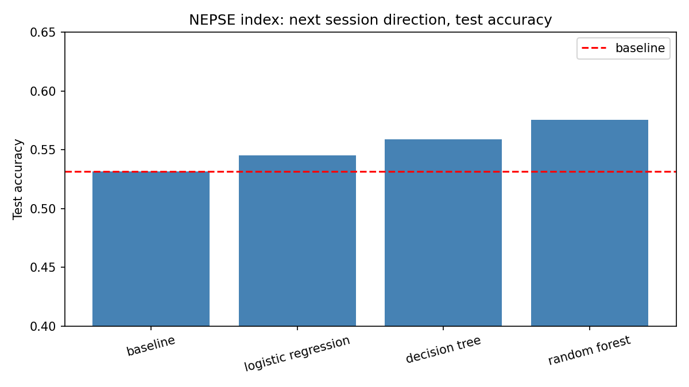
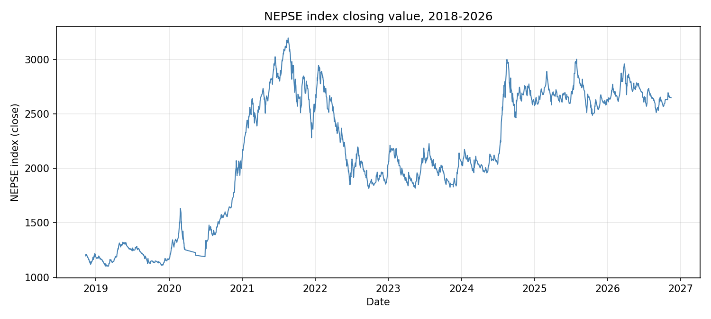
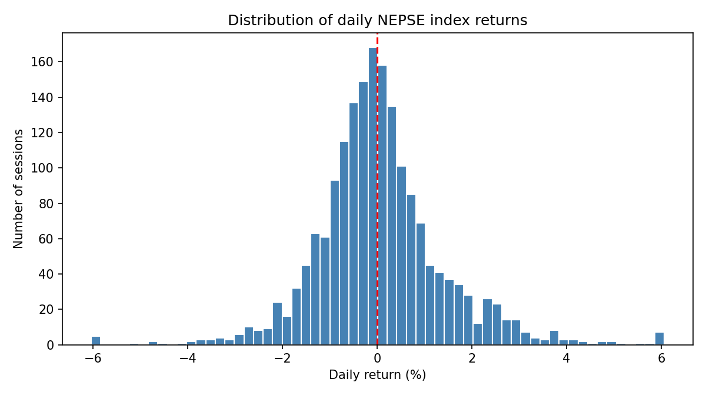

# Predicting NEPSE Index Direction with Machine Learning

A beginner-friendly machine learning project that tests whether past returns and daily price range can classify whether the Nepal Stock Exchange (NEPSE) index will close higher in the next trading session.

## Research question

Using only information available at the close of session *t* (past index returns and daily range), can machine learning classify whether the NEPSE index closes higher at session *t+1*?

## Data

- NEPSE index daily history from the [Nepal Market Data](https://binayabaral.github.io/nepal-market-data/) project (MIT licensed), 1997–2026.
- The CSV is **not included** in this repository. Download `NEPSE_INDEX.csv` from the NEPSE Index page of that site.
- Analysis window: 2018-11-11 to 2026-11-06 (1,828 sessions). Before late 2018 the open, high and low simply repeat the close, so no real daily range exists.

## Method

1. Cleaned and sorted the data; checked data quality (27 sessions have an open or close outside the recorded high–low range; rows kept to preserve the time sequence).
2. Explored the data: closing value over time (the market moved through boom, crash and sideways regimes) and the distribution of daily returns (centred near zero, standard deviation 1.36%, heavier tails than a bell curve).
3. Built features known at the close of session *t*: today's return, the two previous sessions' returns, and daily range as a percentage of the close.
4. Target: 1 if the next session closes higher, otherwise 0.
5. Chronological 80/20 split (train 2018-11-14 to 2025-03-30; test 2025-04-01 to 2026-11-06). No random shuffling, to avoid leaking future information.
6. Compared a baseline (always predict the most common training class), Logistic Regression, a Decision Tree and a Random Forest.
7. Evaluated with accuracy, precision, recall, F1 and confusion matrices, and checked robustness with 5-fold expanding-window time-series cross-validation.

## Results (test set, 365 sessions)

| Model | Accuracy | Precision | Recall | F1 |
|---|---|---|---|---|
| Baseline (always "down") | 0.5315 | 0.000 | 0.000 | 0.000 |
| Logistic Regression | 0.5452 | 0.525 | 0.310 | 0.390 |
| Decision Tree (depth 3) | 0.5589 | 0.539 | 0.404 | 0.462 |
| Random Forest | 0.5753 | 0.558 | 0.450 | 0.498 |





In cross-validation the Random Forest averaged 0.574 accuracy and beat the baseline in all five folds. Full details are in [docs/experiment-log.md](docs/experiment-log.md).

## Key findings

- Past returns and daily range give at most a small edge over a naive guess. The Random Forest's best result is about 4 percentage points above the baseline on the test set.
- That margin is close to what luck alone can produce on 365 test days (about ±2.6 points), so the evidence is suggestive, not conclusive.
- Unlike my earlier gold-price project, where the simple baseline won, the more flexible models did somewhat better here, but the gains are small and inconsistent across time periods.

## Limitations

- Small test set; three models were compared on the same test set, which slightly flatters the best one.
- The baseline is sensitive to shifts in the up/down mix between periods.
- Only four features; no volume, news, macroeconomic or sector information.
- Not a trading strategy: no transaction costs, and the index cannot be bought directly.
- Only four features; turnover was available but not used, and there is no news, macroeconomic or sector information.
  
## Repository structure

```
notebooks/   Kaggle notebook with the full analysis
images/      charts used in this README
docs/        experiment log with all results
```

## How to run

1. Download `NEPSE_INDEX.csv` (see Data).
2. Open the notebook and change the file path in the first code cell to where you saved the CSV.
3. Install the libraries in `requirements.txt` and run all cells.

## Acknowledgements

Data: Nepal Market Data project (MIT licence).
